# ProgramacaoOrientadaObjetos-ADS-Senac

### Herança

Robo é abstrata e guarda o que é comum a todos: dados, energia, pontos, resultados, validações e o cálculo do dano.
RoboOfensivo, RoboDefensivo e RoboEquilibrado estendem Robo e chamam super(...) no construtor, sem repetir atributos.

### Polimorfismo

Uma única ArrayList<Robo> guarda os três tipos.
As subclasses sobrescrevem com @Override métodos da Robo:
getTipo(), nas três.
calcularAtaqueEfetivo(), no ofensivo (ataque + 5, sem alterar o atributo).
reduzirDanoRecebido(), no defensivo (−3, mínimo 2).
calcularDano chama esses métodos no agressor e no alvo, e quem decide o comportamento é o objeto. Não há instanceof nem if por tipo.

### Encapsulamento

Os atributos do robô são private, e as subclasses usam getters.
Não existe setter. Energia, pontos e resultados só mudam por métodos como atacar, registrarVitoria, registrarDerrota, registrarEmpate, registrarFolga e recuperarEnergia.
As validações ficam na Robo: no construtor e em validarRecuperacao.

Imagens da sequencia de codigos
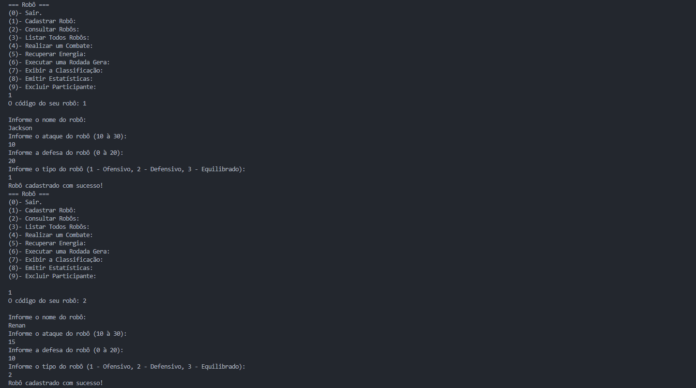
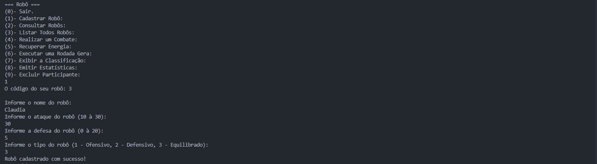
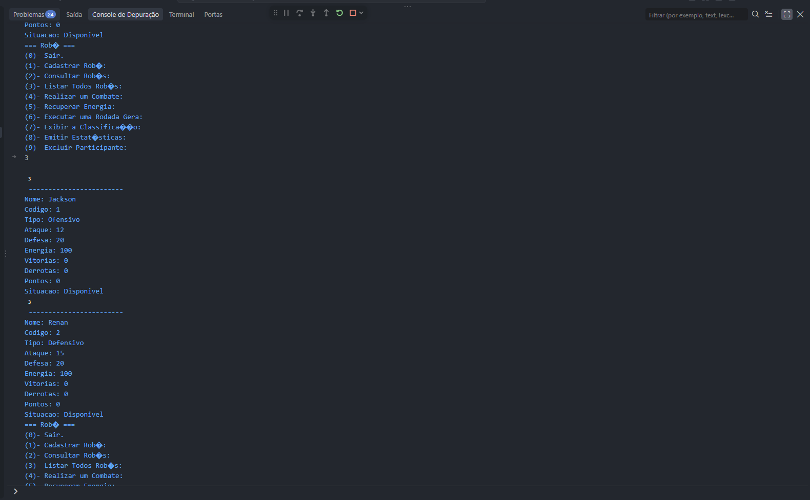
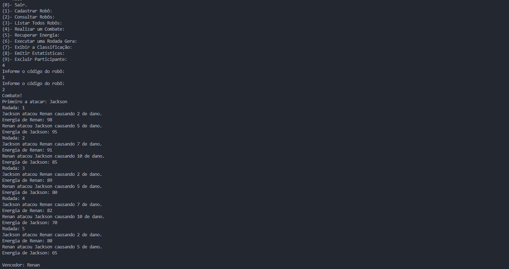
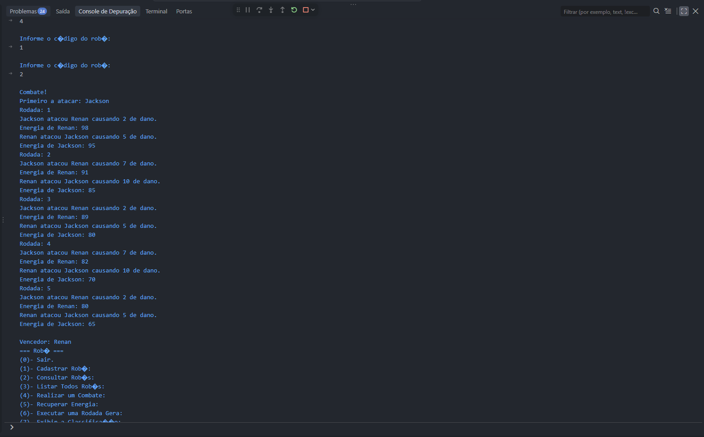
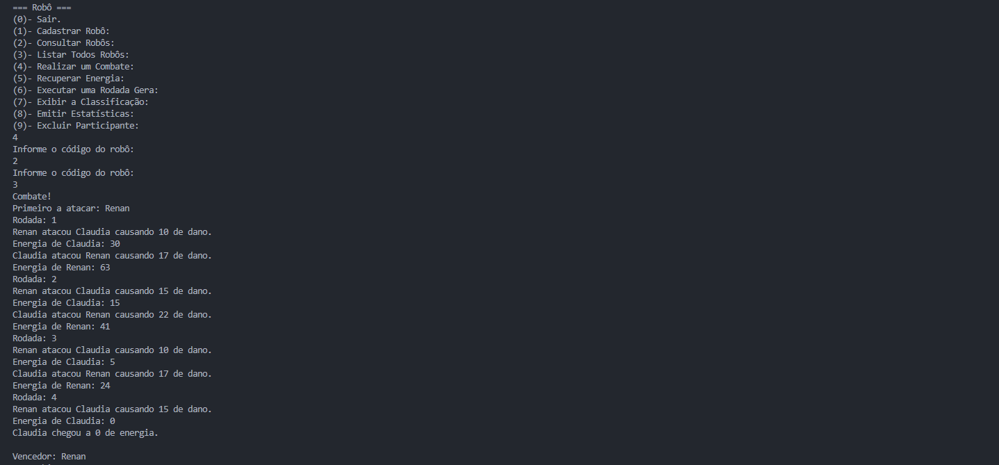

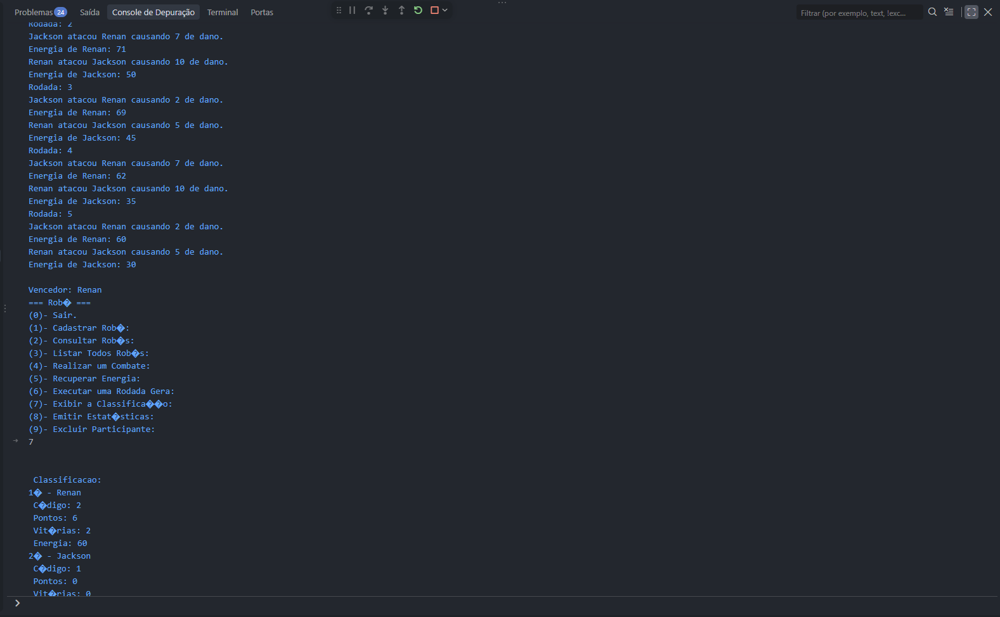
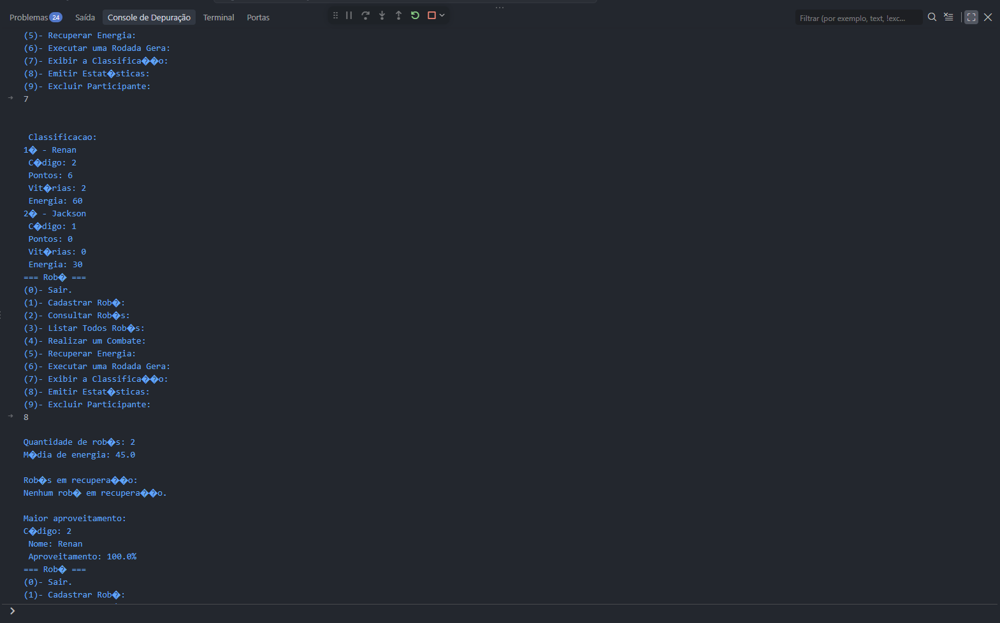
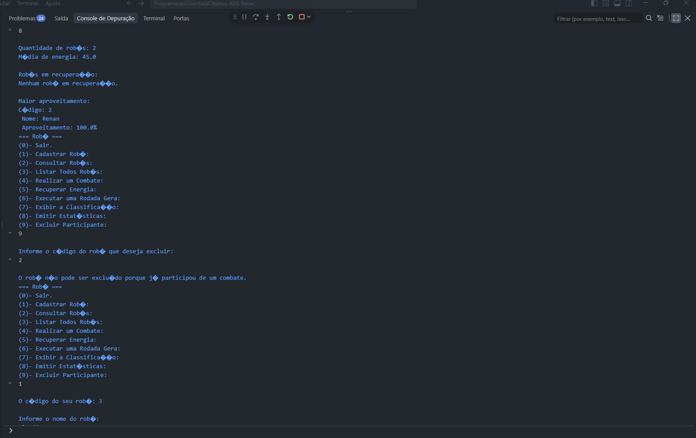
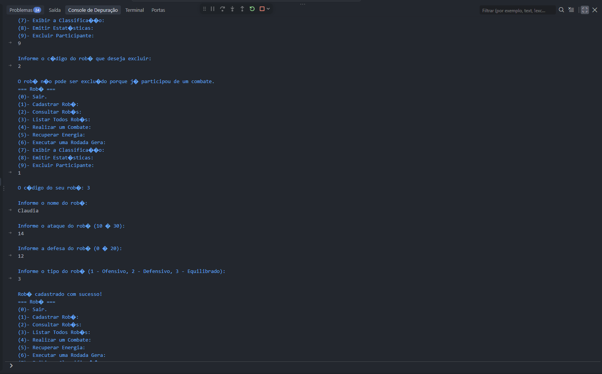
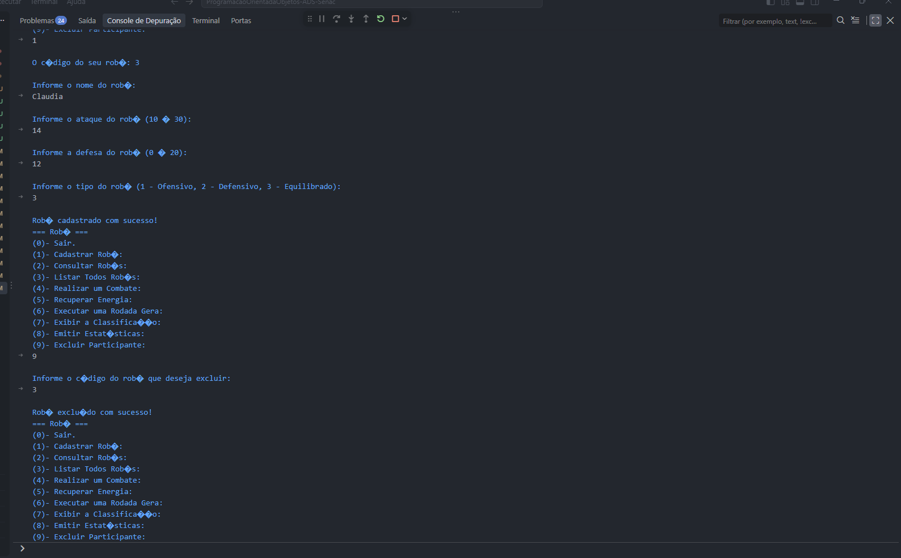
