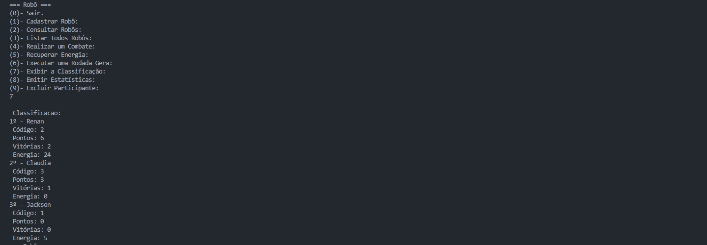

# ProgramacaoOrientadaObjetos-ADS-Senac

### Herança

Robo é abstrata e guarda o que é comum a todos: dados, energia, pontos, resultados, validações e o cálculo do dano.
RoboOfensivo, RoboDefensivo e RoboEquilibrado estendem Robo e chamam super(...) no construtor, sem repetir atributos.

### Polimorfismo

Uma única ArrayList<Robo> guarda os três tipos.
As subclasses sobrescrevem com @Override métodos da Robo:
getTipo(), nas três.
calcularAtaqueEfetivo(), no ofensivo (ataque + 5, sem alterar o atributo).
reduzirDanoRecebido(), no defensivo (−3, mínimo 2).
calcularDano chama esses métodos no agressor e no alvo, e quem decide o comportamento é o objeto. Não há instanceof nem if por tipo.

### Encapsulamento

Os atributos do robô são private, e as subclasses usam getters.
Não existe setter. Energia, pontos e resultados só mudam por métodos como atacar, registrarVitoria, registrarDerrota, registrarEmpate, registrarFolga e recuperarEnergia.
As validações ficam na Robo: no construtor e em validarRecuperacao.

Imagens da sequencia de codigos

### Demonstre um combate para cada combinação:

Criar(1):

Listar(3):

ofensivo contra defensivo(4):

Jackson (ofensivo) atacou Renan (defensivo) na rodada 2 e causou 7 de dano.

- Ataque: 10 + 5 (bônus do ofensivo) = 15
- Defesa do alvo: 15 − 10 = 5 (já atende ao dano mínimo de 5)
- Rodada par: 5 + 5 = 10
- Redução do defensivo: 10 − 3 = **7**

Também aparece o dano mínimo: Renan atacando Jackson na rodada 1 daria 15 − 20 = −5, e o dano mínimo elevou para 5. Renan venceu.

ofensivo contra equilibrado(4):

Jackson (ofensivo) atacou Claudia (equilibrada) na rodada 2 e causou 15 de dano.

- Ataque: 10 + 5 (bônus do ofensivo) = 15
- Defesa do alvo: 15 − 5 = 10
- Rodada par: 10 + 5 = 15
- O equilibrado não reduz o dano: **15**

Claudia venceu.

defensivo contra equilibrado(4):

Claudia (equilibrada) atacou Renan (defensivo) na rodada 2 e causou 22 de dano.

- Ataque: 30 (sem modificador)
- Defesa do alvo: 30 − 10 = 20
- Rodada par: 20 + 5 = 25
- Redução do defensivo: 25 − 3 = **22**

Renan venceu e Claudia chegou a 0 de energia.

Em todos os casos o `Main` só chama `atacar`. O tipo de cada robô define o ataque e a redução do dano por meio dos métodos sobrescritos com `@Override`.

Classificação(7):

